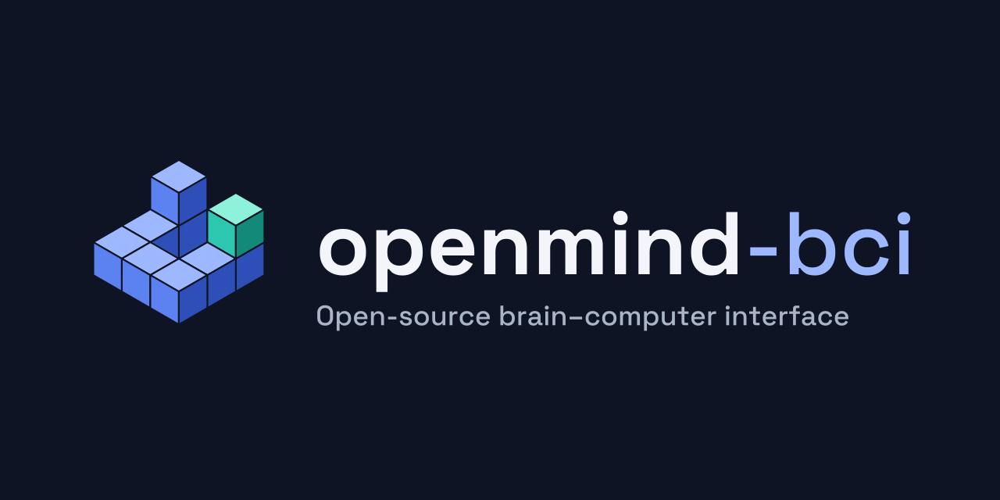

<p align="center">
  
</p>

<p align="center">
  <b>An open-source EEG + AI brain-computer interface.</b><br>
  Calibrate a new user in minutes, then drive small real and virtual objects with your mind.
</p>

> [!WARNING]
> **Research and experimentation project — not a medical device.**
> OpenMind BCI must not be used for diagnosis, treatment or any clinical decision,
> nor to control anything where an error could harm someone.

## What is OpenMind BCI?

OpenMind BCI turns brain activity recorded by an EEG headset into simple commands
(`left`, `right`, `forward`, `rest`, `action`) that can move a robot, a digital
twin or a game character. Two goals drive the project:

- **Fast onboarding**: thanks to transfer learning, a new user should be ready
  after a few minutes of calibration instead of a long training session.
- **Hardware freedom**: any headset, any object. Each layer talks to the next
  through an open, documented standard, so every piece can be swapped.

## Architecture

The platform is split into three independent repositories, connected by two
open contracts: a standard **LSL** stream and a generic **MQTT** protocol.

```
  headset / file / synthetic          intent decoding                 objects
 ┌──────────────────────────┐    ┌────────────────────────┐    ┌──────────────────────┐
 │  plug                    │    │  core                  │    │  sandbox             │
 │  any EEG source          │───▶│  preprocessing         │───▶│  robot, digital twin │
 │  → standard LSL stream   │LSL │  decoder + calibration │MQTT│  wheelchair, bird... │
 └──────────────────────────┘    │  → OpenMind commands   │    └──────────────────────┘
                                 └────────────────────────┘
```

| Repository | Role | Input | Output |
|---|---|---|---|
| [**plug**](https://github.com/openmind-bci/plug) | The universal EEG plug | Headset, recorded file, public dataset, synthetic signal | Standard LSL stream (EEG + markers) |
| [**core**](https://github.com/openmind-bci/core) | The AI core | Standard LSL stream | Generic MQTT commands (OpenMind protocol) |
| [**sandbox**](https://github.com/openmind-bci/sandbox) | Virtual and real objects | MQTT commands (or keyboard) | Object movements, events, markers |

Dependencies only flow one way: `plug → core → sandbox`. Plug does no decoding,
core never talks to a headset and knows nothing about objects, and sandbox only
depends on the `openmind-protocol` package.

## Commands

| Command | Mental task |
|---|---|
| `left` | imagine moving the left hand |
| `right` | imagine moving the right hand |
| `forward` | imagine walking / moving the feet |
| `rest` | relax (default when nothing is detected) |
| `action` | double blink: an eye signal (EOG) used as a hybrid switch |

## Open contracts

- **[LSL stream specification](https://github.com/openmind-bci/plug/blob/main/docs/stream-spec.md)**
  (owned by plug): EEG in microvolts with full channel metadata (10-20 labels,
  units, montage), plus a JSON markers stream.
- **OpenMind protocol** (owned by [core/protocol](https://github.com/openmind-bci/core/tree/main/protocol)):
  versioned JSON messages on `openmind/v1/*` topics (commands, decoder heartbeat,
  markers, events, score, band power). Any real object stops if it no longer
  receives the decoder heartbeat for 2 seconds.

## Status

Early development. Everything can already be run **without a headset**, using a
synthetic EEG source or a replayed public dataset.

| Phase | Scope | Status |
|---|---|---|
| A | Full chain without hardware: sources, offline pipeline on public data, simulators, Godot app, 3D brain | in progress |
| B | Real headset: hardware validation and tuning in real conditions | planned |
| C | Real robot (ESP32): hardware validation | planned |

## Principles

- **Privacy first**: EEG is health data. Processing is 100 % local, user IDs are
  pseudonymized, and no recording is ever stored in a repository.
- **Open and reproducible**: public datasets are downloaded by script, signals
  are seeded, and every repository is typed, linted and tested.
- **Licensed under [Apache-2.0](https://www.apache.org/licenses/LICENSE-2.0).**

## Get involved

Start with [plug's getting started guide](https://github.com/openmind-bci/plug/blob/main/docs/getting-started.md)
to stream EEG without a headset, or read
[Adding a driver](https://github.com/openmind-bci/plug/blob/main/docs/adding-a-driver.md)
to support a new headset. Issues and pull requests are welcome in each repository.
